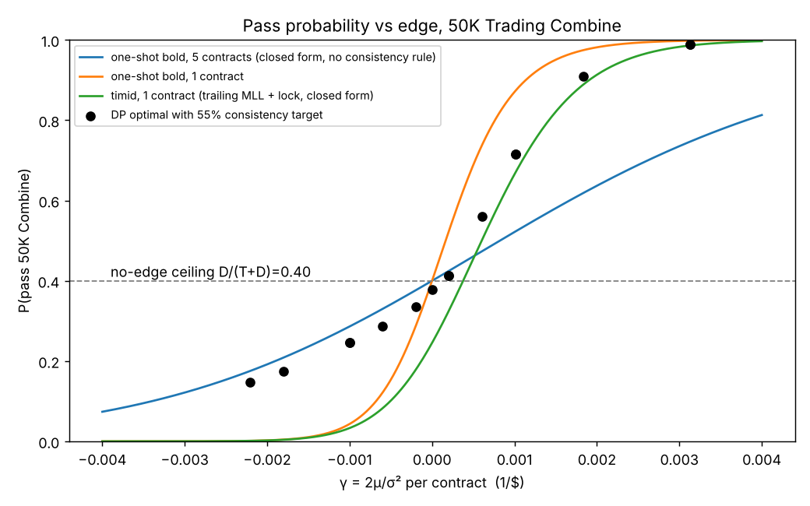
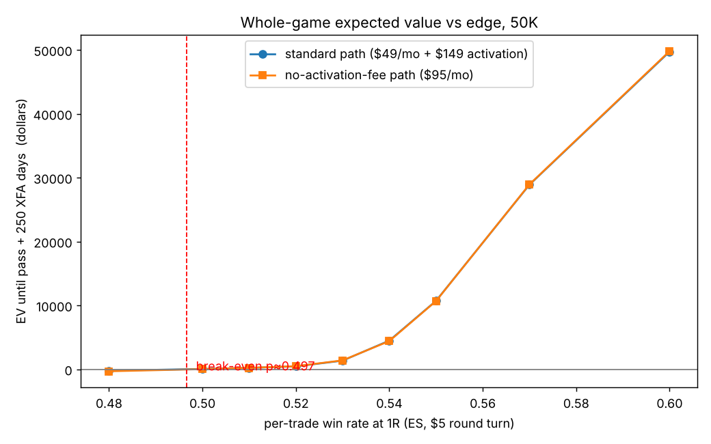
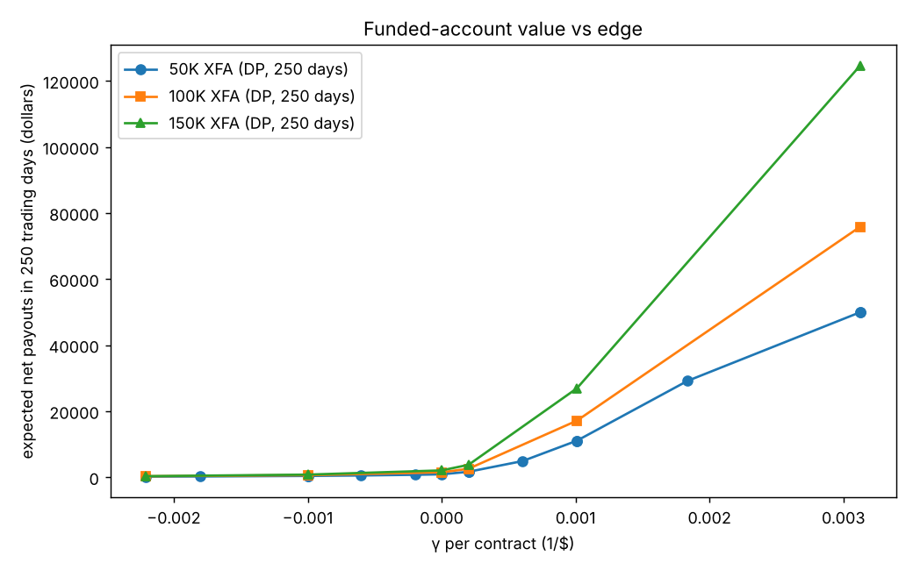

# Results: Topstep Trading Combine and Express Funded Account, solved

Generated from `results/raw/*.json` by `python -m topstep.report`. Rules as of 2026-11-09; edges are per-contract binary trade models (see `docs/TOPSTEP_MATH.md` §1.1). DP = exact dynamic program on end-of-day states; trade-level sim = Monte Carlo of every trade with 20,000 accounts.

### Trading Combine 50K: pass probability and duration

| edge | p_win | γ per contract | bound D/(T+D) | one-shot bold (closed form) | continuous timid (closed form) | **DP optimal** P_pass | E[days] | DP bold | DP timid | trade-level sim (optimal) | trade-level sim (bold) | first action (fresh account) |
|---|---|---|---|---|---|---|---|---|---|---|---|---|
| negative | 0.47 | -0.0022 | 40.0% | 17.5% (k=5) | 0.1% | **14.7%** | 4.3 | 7.1% | 0.1% | 14.2% (4.8 d) | 8.7% | target +1000 / stop -800 with 5 contract(s), P(win day)=0.267, unresolved=0.13 |
| zero_free | 0.50 | +0.0000 | 40.0% | 40.0% (k=1) | 24.5% | **37.8%** | 14.4 | 24.6% | 25.1% | 38.1% (14.3 d) | 24.0% | target +1200 / stop -500 with 5 contract(s), P(win day)=0.234, unresolved=0.03 |
| zero | 0.50 | -0.0010 | 40.0% | 28.6% (k=5) | 3.3% | **24.6%** | 5.9 | 14.6% | 3.5% | 24.7% (6.3 d) | 16.8% | target +1000 / stop -800 with 5 contract(s), P(win day)=0.322, unresolved=0.14 |
| weak | 0.53 | +0.0002 | 40.0% | 52.2% (k=1) | 32.4% | **41.3%** | 33.7 | 28.5% | 32.2% | 39.9% (35.6 d) | 29.1% | target +1200 / stop -500 with 4 contract(s), P(win day)=0.264, unresolved=0.15 |
| modest | 0.55 | +0.0010 | 40.0% | 87.3% (k=1) | 66.9% | **71.6%** | 55.8 | 41.3% | 65.8% | 71.6% (59.0 d) | 39.1% | target +900 / stop -200 with 1 contract(s), P(win day)=0.003, unresolved=0.56 |
| strong | 0.60 | +0.0031 | 40.0% | 99.8% (k=1) | 98.6% | **98.9%** | 30.9 | 70.4% | 98.2% | 99.1% (32.3 d) | 64.7% | target +900 / stop -200 with 1 contract(s), P(win day)=0.006, unresolved=0.66 |

### Express Funded Account 50K (Standard path): value over 250 trading days

| edge | **V (DP, net of 90/10)** | binary-day sim mean | trade-level sim mean | P(any payout) DP-sim / trade-level | P(bust) | mean # payouts | median net payout | 90th pct | first action |
|---|---|---|---|---|---|---|---|---|---|
| negative | **$172** | $171 | $177 | 28.5% / 28.5% | 98.6% | 0.4 | $0 | $540 | target +200 / stop -300 with 2 contract(s), P(win day)=0.427, unresolved=0.03 |
| zero_free | **$872** | $878 | $831 | 34.7% / 33.8% | 100.0% | 0.8 | $0 | $2,970 | target +1500 / stop -200 with 2 contract(s), P(win day)=0.011, unresolved=0.24 |
| zero | **$382** | $375 | $391 | 33.8% / 34.6% | 99.6% | 0.6 | $0 | $1,260 | target +1500 / stop -300 with 2 contract(s), P(win day)=0.012, unresolved=0.44 |
| weak | **$1,639** | $1,643 | $1,554 | 16.5% / 15.8% | 96.5% | 0.9 | $0 | $7,200 | target +2000 / stop -300 with 2 contract(s), P(win day)=0.000, unresolved=0.52 |
| modest | **$11,051** | $11,021 | $11,036 | 56.1% / 56.6% | 70.5% | 6.1 | $5,400 | $30,600 | target +2000 / stop -300 with 2 contract(s), P(win day)=0.000, unresolved=0.56 |
| strong | **$49,941** | $49,844 | $50,011 | 96.7% / 97.0% | 5.6% | 27.7 | $52,200 | $57,600 | target +2000 / stop -700 with 2 contract(s), P(win day)=0.000, unresolved=0.91 |

### Whole-game economics 50K: pay until you pass, then trade the XFA for 250 days

| edge | path | monthly / reset / activation | R_pass = V_XFA − activation | fee-aware P_pass | E[days] per attempt | quits at start? | P(pass within 3 / 6 attempts) | E[trading days until pass] | **E[cost until pass]** | **EV until pass (fee-aware)** | EV with pure P-max policy |
|---|---|---|---|---|---|---|---|---|---|---|---|
| negative | standard | $49 / $49 / $149 | $23 | 0.0% | 0.0 | yes | 0.0% / 0.0% | inf | **$—** | **$—** | $-331 |
| negative | noaf | $95 / $95 / $0 | $172 | 13.3% | 2.3 | no | 34.7% / 57.4% | 17.4 | **$700** | **$-528** | $-515 |
| zero_free | standard | $49 / $49 / $149 | $723 | 37.4% | 6.1 | no | 75.5% / 94.0% | 16.2 | **$120** | **$603** | $553 |
| zero_free | noaf | $95 / $95 / $0 | $872 | 37.3% | 5.7 | no | 75.3% / 93.9% | 15.4 | **$230** | **$642** | $543 |
| zero | standard | $49 / $49 / $149 | $233 | 24.1% | 3.4 | no | 56.2% / 80.8% | 14.0 | **$187** | **$46** | $27 |
| zero | noaf | $95 / $95 / $0 | $382 | 24.0% | 3.3 | no | 56.2% / 80.8% | 13.9 | **$363** | **$19** | $-18 |
| weak | standard | $49 / $49 / $149 | $1,490 | 39.6% | 11.5 | no | 78.0% / 95.2% | 29.1 | **$143** | **$1,347** | $1,229 |
| weak | noaf | $95 / $95 / $0 | $1,639 | 39.0% | 8.7 | no | 77.3% / 94.8% | 22.4 | **$250** | **$1,389** | $1,134 |
| modest | standard | $49 / $49 / $149 | $10,902 | 71.6% | 52.8 | no | 97.7% / 99.9% | 73.7 | **$192** | **$10,711** | $10,701 |
| modest | noaf | $95 / $95 / $0 | $11,051 | 71.6% | 52.3 | no | 97.7% / 99.9% | 73.1 | **$368** | **$10,683** | $10,661 |
| strong | standard | $49 / $49 / $149 | $49,792 | 98.9% | 27.3 | no | 100.0% / 100.0% | 27.6 | **$65** | **$49,727** | $49,718 |
| strong | noaf | $95 / $95 / $0 | $49,941 | 98.9% | 27.1 | no | 100.0% / 100.0% | 27.4 | **$125** | **$49,816** | $49,798 |

### Trading Combine 50K with optional DLL: pass probability and duration

| edge | p_win | γ per contract | bound D/(T+D) | one-shot bold (closed form) | continuous timid (closed form) | **DP optimal** P_pass | E[days] | DP bold | DP timid | trade-level sim (optimal) | trade-level sim (bold) | first action (fresh account) |
|---|---|---|---|---|---|---|---|---|---|---|---|---|
| zero | 0.50 | -0.0010 | 40.0% | 28.6% (k=5) | 3.3% | **24.5%** | 6.3 | 11.9% | 3.5% | 24.3% (6.6 d) | 16.8% | target +1000 / stop -800 with 5 contract(s), P(win day)=0.322, unresolved=0.14 |
| modest | 0.55 | +0.0010 | 40.0% | 87.3% (k=1) | 66.9% | **71.6%** | 55.8 | 45.2% | 65.8% | 71.6% (59.0 d) | 39.1% | target +900 / stop -200 with 1 contract(s), P(win day)=0.003, unresolved=0.56 |
| strong | 0.60 | +0.0031 | 40.0% | 99.8% (k=1) | 98.6% | **98.9%** | 30.9 | 81.2% | 98.2% | 99.1% (32.3 d) | 64.7% | target +900 / stop -200 with 1 contract(s), P(win day)=0.006, unresolved=0.66 |

### Express Funded Account 50K (Standard path, DLL-doubled cap): value over 250 trading days

| edge | **V (DP, net of 90/10)** | binary-day sim mean | trade-level sim mean | P(any payout) DP-sim / trade-level | P(bust) | mean # payouts | median net payout | 90th pct | first action |
|---|---|---|---|---|---|---|---|---|---|
| zero | **$382** | $377 | $390 | 34.0% / 34.6% | 99.5% | 0.6 | $0 | $1,260 | target +1500 / stop -300 with 2 contract(s), P(win day)=0.012, unresolved=0.44 |
| modest | **$11,678** | $11,590 | $11,660 | 57.1% / 57.7% | 75.9% | 3.3 | $7,200 | $32,220 | target +2000 / stop -300 with 2 contract(s), P(win day)=0.000, unresolved=0.56 |
| strong | **$76,181** | $76,312 | $76,446 | 97.0% / 97.1% | 11.3% | 21.3 | $79,200 | $96,480 | target +2000 / stop -700 with 2 contract(s), P(win day)=0.000, unresolved=0.91 |

### Whole-game economics 50K with DLL: pay until you pass, then trade the XFA for 250 days

| edge | path | monthly / reset / activation | R_pass = V_XFA − activation | fee-aware P_pass | E[days] per attempt | quits at start? | P(pass within 3 / 6 attempts) | E[trading days until pass] | **E[cost until pass]** | **EV until pass (fee-aware)** | EV with pure P-max policy |
|---|---|---|---|---|---|---|---|---|---|---|---|
| zero | standard | $49 / $49 / $149 | $233 | 24.1% | 4.3 | no | 56.2% / 80.8% | 17.8 | **$196** | **$37** | $22 |
| zero | noaf | $95 / $95 / $0 | $382 | 24.0% | 4.2 | no | 56.1% / 80.7% | 17.7 | **$381** | **$1** | $-27 |
| modest | standard | $49 / $49 / $149 | $11,529 | 71.6% | 52.8 | no | 97.7% / 99.9% | 73.8 | **$192** | **$11,338** | $11,328 |
| modest | noaf | $95 / $95 / $0 | $11,678 | 71.6% | 52.4 | no | 97.7% / 99.9% | 73.2 | **$369** | **$11,310** | $11,288 |
| strong | standard | $49 / $49 / $149 | $76,032 | 98.9% | 27.8 | no | 100.0% / 100.0% | 28.1 | **$66** | **$75,966** | $75,958 |
| strong | noaf | $95 / $95 / $0 | $76,181 | 98.9% | 27.2 | no | 100.0% / 100.0% | 27.5 | **$125** | **$76,055** | $76,038 |

### Trading Combine 100K: pass probability and duration

| edge | p_win | γ per contract | bound D/(T+D) | one-shot bold (closed form) | continuous timid (closed form) | **DP optimal** P_pass | E[days] | DP bold | DP timid | trade-level sim (optimal) | trade-level sim (bold) | first action (fresh account) |
|---|---|---|---|---|---|---|---|---|---|---|---|---|
| negative | 0.47 | -0.0022 | 33.3% | 14.9% (k=10) | 0.0% | **12.1%** | 4.1 | 6.0% | 0.0% | 11.9% (4.2 d) | 7.4% | target +2000 / stop -1200 with 10 contract(s), P(win day)=0.259, unresolved=0.06 |
| zero_free | 0.50 | +0.0000 | 33.3% | 33.3% (k=1) | 18.4% | **31.6%** | 10.3 | 20.3% | 18.7% | 31.9% (10.3 d) | 19.7% | target +2500 / stop -800 with 8 contract(s), P(win day)=0.161, unresolved=0.09 |
| zero | 0.50 | -0.0010 | 33.3% | 24.0% (k=10) | 0.2% | **20.3%** | 5.8 | 12.0% | 0.2% | 20.4% (6.0 d) | 13.9% | target +3000 / stop -1000 with 9 contract(s), P(win day)=0.196, unresolved=0.12 |
| weak | 0.53 | +0.0002 | 33.3% | 54.1% (k=1) | 31.2% | **38.6%** | 105.2 | 24.0% | 30.7% | 37.2% (107.8 d) | 24.1% | target +3000 / stop -800 with 7 contract(s), P(win day)=0.138, unresolved=0.23 |
| modest | 0.55 | +0.0010 | 33.3% | 95.2% (k=1) | 81.8% | **83.9%** | 138.9 | 35.8% | 80.5% | 84.7% (143.5 d) | 32.4% | target +900 / stop -200 with 1 contract(s), P(win day)=0.003, unresolved=0.56 |
| strong | 0.60 | +0.0031 | 33.3% | 100.0% (k=1) | 99.9% | **99.9%** | 65.6 | 60.8% | 99.9% | 100.0% (66.9 d) | 55.3% | target +900 / stop -200 with 1 contract(s), P(win day)=0.006, unresolved=0.66 |

### Express Funded Account 100K (Standard path): value over 250 trading days

| edge | **V (DP, net of 90/10)** | binary-day sim mean | trade-level sim mean | P(any payout) DP-sim / trade-level | P(bust) | mean # payouts | median net payout | 90th pct | first action |
|---|---|---|---|---|---|---|---|---|---|
| negative | **$277** | $279 | $286 | 29.5% / 29.9% | 99.4% | 0.5 | $0 | $990 | target +300 / stop -400 with 3 contract(s), P(win day)=0.420, unresolved=0.01 |
| zero_free | **$1,473** | $1,504 | $1,452 | 23.6% / 23.2% | 100.0% | 0.6 | $0 | $5,400 | target +1500 / stop -300 with 3 contract(s), P(win day)=0.088, unresolved=0.16 |
| zero | **$612** | $606 | $614 | 32.0% / 31.7% | 99.5% | 0.7 | $0 | $2,160 | target +1500 / stop -400 with 3 contract(s), P(win day)=0.064, unresolved=0.32 |
| weak | **$2,552** | $2,480 | $2,440 | 17.7% / 17.3% | 98.0% | 0.9 | $0 | $10,800 | target +3000 / stop -400 with 3 contract(s), P(win day)=0.000, unresolved=0.45 |
| modest | **$17,118** | $16,949 | $16,918 | 61.7% / 62.0% | 70.7% | 6.3 | $13,500 | $43,200 | target +3000 / stop -800 with 3 contract(s), P(win day)=0.000, unresolved=0.75 |
| strong | **$75,829** | $75,802 | $75,836 | 98.3% / 98.5% | 4.4% | 28.1 | $78,300 | $86,400 | target +3000 / stop -1500 with 3 contract(s), P(win day)=0.000, unresolved=0.97 |

### Whole-game economics 100K: pay until you pass, then trade the XFA for 250 days

| edge | path | monthly / reset / activation | R_pass = V_XFA − activation | fee-aware P_pass | E[days] per attempt | quits at start? | P(pass within 3 / 6 attempts) | E[trading days until pass] | **E[cost until pass]** | **EV until pass (fee-aware)** | EV with pure P-max policy |
|---|---|---|---|---|---|---|---|---|---|---|---|
| negative | standard | $99 / $99 / $149 | $128 | 11.3% | 2.1 | no | 30.3% / 51.4% | 18.2 | **$859** | **$-731** | $-750 |
| negative | noaf | $149 / $149 / $0 | $277 | 11.6% | 2.1 | no | 30.9% / 52.3% | 18.5 | **$1,267** | **$-990** | $-1,044 |
| zero_free | standard | $99 / $99 / $149 | $1,324 | 30.9% | 4.4 | no | 67.0% / 89.1% | 14.1 | **$288** | **$1,036** | $958 |
| zero_free | noaf | $149 / $149 / $0 | $1,473 | 30.9% | 4.3 | no | 66.9% / 89.1% | 14.0 | **$433** | **$1,040** | $921 |
| zero | standard | $99 / $99 / $149 | $463 | 19.3% | 2.7 | no | 47.5% / 72.4% | 13.8 | **$478** | **$-15** | $-59 |
| zero | noaf | $149 / $149 / $0 | $612 | 19.3% | 2.6 | no | 47.5% / 72.4% | 13.7 | **$720** | **$-108** | $-174 |
| weak | standard | $99 / $99 / $149 | $2,403 | 33.1% | 10.0 | no | 70.1% / 91.0% | 30.4 | **$343** | **$2,060** | $961 |
| weak | noaf | $149 / $149 / $0 | $2,552 | 32.6% | 8.1 | no | 69.4% / 90.7% | 24.8 | **$483** | **$2,068** | $382 |
| modest | standard | $99 / $99 / $149 | $16,969 | 83.8% | 132.1 | no | 99.6% / 100.0% | 157.5 | **$762** | **$16,207** | $16,169 |
| modest | noaf | $149 / $149 / $0 | $17,118 | 83.8% | 129.7 | no | 99.6% / 100.0% | 154.9 | **$1,128** | **$15,990** | $15,914 |
| strong | standard | $99 / $99 / $149 | $75,680 | 99.9% | 34.0 | no | 100.0% / 100.0% | 34.0 | **$160** | **$75,519** | $75,370 |
| strong | noaf | $149 / $149 / $0 | $75,829 | 99.9% | 32.3 | no | 100.0% / 100.0% | 32.4 | **$230** | **$75,599** | $75,363 |

### Trading Combine 150K: pass probability and duration

| edge | p_win | γ per contract | bound D/(T+D) | one-shot bold (closed form) | continuous timid (closed form) | **DP optimal** P_pass | E[days] | DP bold | DP timid | trade-level sim (optimal) | trade-level sim (bold) | first action (fresh account) |
|---|---|---|---|---|---|---|---|---|---|---|---|---|
| negative | 0.47 | -0.0022 | 33.3% | 14.9% (k=15) | 0.0% | **11.7%** | 2.8 | 5.2% | 0.0% | 11.7% (2.9 d) | 7.4% | target +3000 / stop -4500 with 15 contract(s), P(win day)=0.283, unresolved=0.31 |
| zero_free | 0.50 | +0.0000 | 33.3% | 33.3% (k=1) | 18.4% | **30.8%** | 42.9 | 20.0% | 19.0% | 30.1% (43.6 d) | 19.7% | target +4500 / stop -1200 with 12 contract(s), P(win day)=0.161, unresolved=0.09 |
| zero | 0.50 | -0.0010 | 33.3% | 24.0% (k=15) | 0.0% | **19.4%** | 5.0 | 10.5% | 0.0% | 19.2% (5.2 d) | 13.9% | target +3000 / stop -3000 with 15 contract(s), P(win day)=0.322, unresolved=0.14 |
| weak | 0.53 | +0.0002 | 33.3% | 63.7% (k=1) | 38.5% | **43.7%** | 290.6 | 23.5% | 37.2% | 34.9% (275.2 d) | 24.1% | target +4500 / stop -1050 with 10 contract(s), P(win day)=0.117, unresolved=0.18 |
| modest | 0.55 | +0.0010 | 33.3% | 98.9% (k=1) | 94.2% | **94.3%** | 262.7 | 36.8% | 92.3% | 93.6% (267.4 d) | 32.4% | target +900 / stop -150 with 1 contract(s), P(win day)=0.003, unresolved=0.56 |
| strong | 0.60 | +0.0031 | 33.3% | 100.0% (k=1) | 100.0% | **100.0%** | 96.0 | 61.9% | 100.0% | 100.0% (96.6 d) | 55.3% | target +900 / stop -150 with 1 contract(s), P(win day)=0.006, unresolved=0.66 |

### Express Funded Account 150K (Standard path): value over 250 trading days

| edge | **V (DP, net of 90/10)** | binary-day sim mean | trade-level sim mean | P(any payout) DP-sim / trade-level | P(bust) | mean # payouts | median net payout | 90th pct | first action |
|---|---|---|---|---|---|---|---|---|---|
| negative | **$307** | $310 | $301 | 31.8% / 30.8% | 100.0% | 0.5 | $0 | $1,080 | target +300 / stop -450 with 3 contract(s), P(win day)=0.427, unresolved=0.03 |
| zero_free | **$2,055** | $2,059 | $1,995 | 29.2% / 29.3% | 100.0% | 0.6 | $0 | $7,020 | target +3000 / stop -300 with 3 contract(s), P(win day)=0.001, unresolved=0.25 |
| zero | **$777** | $776 | $753 | 20.3% / 20.1% | 100.0% | 0.6 | $0 | $3,915 | target +1200 / stop -450 with 3 contract(s), P(win day)=0.107, unresolved=0.34 |
| weak | **$3,745** | $3,675 | $3,622 | 16.2% / 15.8% | 98.2% | 0.8 | $0 | $13,365 | target +3000 / stop -3000 with 3 contract(s), P(win day)=0.000, unresolved=1.00 |
| modest | **$26,911** | $26,814 | $26,644 | 62.4% / 62.4% | 70.9% | 6.0 | $17,820 | $71,280 | target +3000 / stop -3000 with 3 contract(s), P(win day)=0.000, unresolved=1.00 |
| strong | **$124,632** | $124,344 | $125,644 | 98.7% / 99.1% | 4.5% | 27.9 | $129,195 | $142,560 | target +3000 / stop -3000 with 3 contract(s), P(win day)=0.000, unresolved=1.00 |

### Whole-game economics 150K: pay until you pass, then trade the XFA for 250 days

| edge | path | monthly / reset / activation | R_pass = V_XFA − activation | fee-aware P_pass | E[days] per attempt | quits at start? | P(pass within 3 / 6 attempts) | E[trading days until pass] | **E[cost until pass]** | **EV until pass (fee-aware)** | EV with pure P-max policy |
|---|---|---|---|---|---|---|---|---|---|---|---|
| negative | standard | $199 / $199 / $149 | $158 | 0.0% | 0.0 | yes | 0.0% / 0.0% | inf | **$—** | **$—** | $-1,571 |
| negative | noaf | $229 / $229 / $0 | $307 | 10.9% | 2.0 | no | 29.4% / 50.1% | 18.4 | **$2,066** | **$-1,759** | $-1,683 |
| zero_free | standard | $199 / $199 / $149 | $1,906 | 29.6% | 3.8 | no | 65.1% / 87.8% | 12.9 | **$595** | **$1,310** | $139 |
| zero_free | noaf | $229 / $229 / $0 | $2,055 | 29.6% | 3.8 | no | 65.1% / 87.8% | 12.8 | **$685** | **$1,370** | $22 |
| zero | standard | $199 / $199 / $149 | $628 | 18.8% | 2.7 | no | 46.4% / 71.3% | 14.4 | **$998** | **$-370** | $-442 |
| zero | noaf | $229 / $229 / $0 | $777 | 18.8% | 2.7 | no | 46.4% / 71.3% | 14.4 | **$1,148** | **$-371** | $-454 |
| weak | standard | $199 / $199 / $149 | $3,596 | 31.2% | 7.8 | no | 67.4% / 89.4% | 25.0 | **$676** | **$2,919** | $-2,963 |
| weak | noaf | $229 / $229 / $0 | $3,745 | 31.1% | 7.3 | no | 67.2% / 89.3% | 23.6 | **$766** | **$2,978** | $-3,803 |
| modest | standard | $199 / $199 / $149 | $26,762 | 93.4% | 186.8 | no | 100.0% / 100.0% | 199.9 | **$1,908** | **$24,854** | $24,110 |
| modest | noaf | $229 / $229 / $0 | $26,911 | 93.3% | 184.4 | no | 100.0% / 100.0% | 197.5 | **$2,170** | **$24,741** | $23,859 |
| strong | standard | $199 / $199 / $149 | $124,483 | 100.0% | 27.7 | no | 100.0% / 100.0% | 27.8 | **$263** | **$124,220** | $123,573 |
| strong | noaf | $229 / $229 / $0 | $124,632 | 100.0% | 27.6 | no | 100.0% / 100.0% | 27.6 | **$301** | **$124,330** | $123,584 |

### Break-even sweep (50K, ES R=L=$100, $5 RT, 10 trades/day): win rate → EV

| p_win | γ/contract | ann. Sharpe | DP P_pass | V_XFA (250 d) | E[cost until pass] std | **EV until pass, standard** | EV until pass, no-activation-fee | E[days until pass] |
|---|---|---|---|---|---|---|---|---|
| 0.48 | -0.0018 | -4.5 | 17.5% | $222 | $297 | **$-224** | $-316 | 15.3 |
| 0.50 | -0.0010 | -2.5 | 24.6% | $382 | $187 | **$46** | $19 | 14.0 |
| 0.51 | -0.0006 | -1.5 | 28.7% | $521 | $156 | **$216** | $219 | 13.1 |
| 0.52 | -0.0002 | -0.5 | 33.6% | $727 | $135 | **$444** | $474 | 14.4 |
| 0.53 | +0.0002 | +0.5 | 41.3% | $1,639 | $143 | **$1,347** | $1,389 | 29.1 |
| 0.54 | +0.0006 | +1.5 | 55.9% | $4,875 | $242 | **$4,484** | $4,415 | 87.1 |
| 0.55 | +0.0010 | +2.5 | 71.6% | $11,051 | $192 | **$10,711** | $10,683 | 73.7 |
| 0.57 | +0.0018 | +4.6 | 91.0% | $29,159 | $113 | **$28,897** | $28,942 | 46.4 |
| 0.60 | +0.0031 | +7.7 | 98.9% | $49,941 | $65 | **$49,727** | $49,816 | 27.6 |

Break-even win rate at 1R (standard path): **p_win ≈ 0.497**.

### Optimal Combine policy along a fresh account (50K, MLL still at −D)

**zero** — zero edge after $5 RT costs (coin flip): p_win=0.500 R=100 L=100 cost=5.00 -> mu=-5.00$/trade sigma=100.0 gamma=-0.00100/$ per-trade Sharpe=-0.050 annual Sharpe~-2.51 (10 trades/day)

| balance vs start | optimal daily action | P(pass from here) |
|---|---|---|
| -1,900 | quit | 0.0% |
| -1,600 | target +300 / stop -400 with 3 contract(s), P(win day)=0.477, unresolved=0.01 | 5.6% |
| -1,300 | target +1000 / stop -700 with 5 contract(s), P(win day)=0.322, unresolved=0.11 | 9.4% |
| -1,000 | target +100 / stop -200 with 1 contract(s), P(win day)=0.484, unresolved=0.03 | 12.2% |
| -700 | target +300 / stop -400 with 3 contract(s), P(win day)=0.477, unresolved=0.01 | 15.6% |
| -400 | target +1000 / stop -600 with 5 contract(s), P(win day)=0.312, unresolved=0.06 | 19.1% |
| -100 | target +1000 / stop -800 with 5 contract(s), P(win day)=0.322, unresolved=0.14 | 23.2% |
| +200 | target +1000 / stop -1200 with 5 contract(s), P(win day)=0.342, unresolved=0.21 | 27.7% |
| +500 | target +1000 / stop -1500 with 5 contract(s), P(win day)=0.342, unresolved=0.32 | 32.2% |
| +800 | target +1000 / stop -2000 with 5 contract(s), P(win day)=0.344, unresolved=0.43 | 37.9% |
| +1,100 | target +1000 / stop -2000 with 5 contract(s), P(win day)=0.344, unresolved=0.43 | 44.2% |
| +1,400 | target +1000 / stop -2000 with 5 contract(s), P(win day)=0.344, unresolved=0.43 | 51.3% |
| +1,700 | target +1000 / stop -2000 with 5 contract(s), P(win day)=0.344, unresolved=0.43 | 58.7% |
| +2,000 | target +500 / stop -2000 with 5 contract(s), P(win day)=0.548, unresolved=0.24 | 66.4% |
| +2,300 | target +400 / stop -2000 with 4 contract(s), P(win day)=0.549, unresolved=0.34 | 74.0% |
| +2,600 | target +200 / stop -900 with 2 contract(s), P(win day)=0.549, unresolved=0.28 | 81.5% |
| +2,900 | target +100 / stop -200 with 1 contract(s), P(win day)=0.484, unresolved=0.03 | 92.1% |

**modest** — modest edge (55% at 1R): p_win=0.550 R=100 L=100 cost=5.00 -> mu=5.00$/trade sigma=99.5 gamma=+0.00101/$ per-trade Sharpe=+0.050 annual Sharpe~+2.52 (10 trades/day)

| balance vs start | optimal daily action | P(pass from here) |
|---|---|---|
| -1,900 | quit | 0.0% |
| -1,600 | target +400 / stop -400 with 3 contract(s), P(win day)=0.572, unresolved=0.01 | 29.7% |
| -1,300 | target +100 / stop -300 with 1 contract(s), P(win day)=0.643, unresolved=0.12 | 43.2% |
| -1,000 | target +100 / stop -600 with 1 contract(s), P(win day)=0.657, unresolved=0.31 | 53.3% |
| -700 | target +400 / stop -200 with 1 contract(s), P(win day)=0.171, unresolved=0.39 | 60.7% |
| -400 | target +100 / stop -1000 with 1 contract(s), P(win day)=0.657, unresolved=0.34 | 66.3% |
| -100 | target +900 / stop -200 with 1 contract(s), P(win day)=0.003, unresolved=0.56 | 70.4% |
| +200 | target +1500 / stop -300 with 2 contract(s), P(win day)=0.025, unresolved=0.54 | 73.8% |
| +500 | target +1500 / stop -400 with 3 contract(s), P(win day)=0.113, unresolved=0.38 | 77.2% |
| +800 | target +1200 / stop -500 with 4 contract(s), P(win day)=0.304, unresolved=0.16 | 80.6% |
| +1,100 | target +1000 / stop -900 with 5 contract(s), P(win day)=0.424, unresolved=0.15 | 83.8% |
| +1,400 | target +500 / stop -1200 with 5 contract(s), P(win day)=0.643, unresolved=0.06 | 86.7% |
| +1,700 | target +400 / stop -1500 with 4 contract(s), P(win day)=0.656, unresolved=0.21 | 89.6% |
| +2,000 | target +400 / stop -2000 with 4 contract(s), P(win day)=0.657, unresolved=0.28 | 92.3% |
| +2,300 | target +200 / stop -2000 with 2 contract(s), P(win day)=0.657, unresolved=0.34 | 94.8% |
| +2,600 | target +100 / stop -1000 with 1 contract(s), P(win day)=0.657, unresolved=0.34 | 97.4% |
| +2,900 | target +100 / stop -200 with 1 contract(s), P(win day)=0.581, unresolved=0.03 | 99.2% |

**strong** — strong edge (60% at 1R): p_win=0.600 R=100 L=100 cost=5.00 -> mu=15.00$/trade sigma=98.0 gamma=+0.00313/$ per-trade Sharpe=+0.153 annual Sharpe~+7.69 (10 trades/day)

| balance vs start | optimal daily action | P(pass from here) |
|---|---|---|
| -1,900 | quit | 0.0% |
| -1,600 | target +100 / stop -400 with 1 contract(s), P(win day)=0.755, unresolved=0.16 | 69.6% |
| -1,300 | target +100 / stop -400 with 1 contract(s), P(win day)=0.755, unresolved=0.16 | 87.1% |
| -1,000 | target +100 / stop -700 with 1 contract(s), P(win day)=0.756, unresolved=0.24 | 94.2% |
| -700 | target +100 / stop -700 with 1 contract(s), P(win day)=0.756, unresolved=0.24 | 97.1% |
| -400 | target +100 / stop -1000 with 1 contract(s), P(win day)=0.756, unresolved=0.24 | 98.3% |
| -100 | target +900 / stop -200 with 1 contract(s), P(win day)=0.006, unresolved=0.66 | 98.8% |
| +200 | target +900 / stop -200 with 1 contract(s), P(win day)=0.006, unresolved=0.66 | 99.0% |
| +500 | target +1500 / stop -400 with 3 contract(s), P(win day)=0.184, unresolved=0.42 | 99.2% |
| +800 | target +1200 / stop -500 with 4 contract(s), P(win day)=0.414, unresolved=0.16 | 99.4% |
| +1,100 | target +1000 / stop -700 with 5 contract(s), P(win day)=0.534, unresolved=0.11 | 99.5% |
| +1,400 | target +500 / stop -1200 with 5 contract(s), P(win day)=0.742, unresolved=0.05 | 99.6% |
| +1,700 | target +400 / stop -1500 with 4 contract(s), P(win day)=0.755, unresolved=0.16 | 99.8% |
| +2,000 | target +300 / stop -2000 with 3 contract(s), P(win day)=0.756, unresolved=0.24 | 99.8% |
| +2,300 | target +100 / stop -1000 with 1 contract(s), P(win day)=0.756, unresolved=0.24 | 99.9% |
| +2,600 | target +100 / stop -1000 with 1 contract(s), P(win day)=0.756, unresolved=0.24 | 100.0% |
| +2,900 | target +100 / stop -200 with 1 contract(s), P(win day)=0.675, unresolved=0.03 | 100.0% |

### Standard vs Consistency payout path (trade-level simulation, best fixed daily policy, 250 days)

The DP covers the Standard path exactly; here each variant gets the best *fixed* policy (daily target / stop / lots, payout requested on the first eligible day) from a grid search, so the numbers are lower bounds on each variant's value and comparable with each other.

| size | edge | variant | best fixed policy | mean net payout | P(any payout) | median | mean # payouts | P(bust) |
|---|---|---|---|---|---|---|---|---|
| 50K | zero | standard | +200 / −500 × 3 lots | $314 | 51.3% | $122 | 0.7 | 100.0% |
| 50K | zero | consistency | +200 / −800 × 3 lots | $364 | 44.4% | $0 | 0.6 | 100.0% |
| 50K | zero | standard_dll | +200 / −500 × 3 lots | $314 | 51.3% | $122 | 0.7 | 100.0% |
| 50K | zero | consistency_dll | +200 / −800 × 3 lots | $364 | 44.4% | $0 | 0.6 | 100.0% |

### Figures

